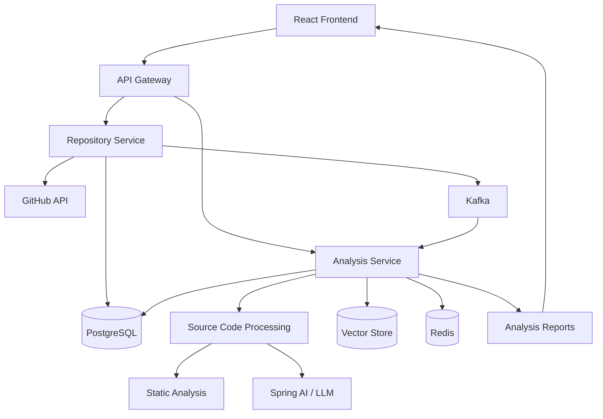

# RepoInsight 🔍

**AI-Powered GitHub Repository Intelligence Platform**

RepoInsight is a full-stack application designed to analyze GitHub repositories, understand their architecture, generate AI-powered technical documentation, and answer questions about source code using Retrieval-Augmented Generation (RAG).

The project combines **Java, Spring Boot, React, microservices, Apache Kafka, Redis, Docker, and Generative AI** to explore real-world backend engineering, distributed systems, and AI integration.

> 🚧 **Status:** In active development. Features and architecture will evolve as the project progresses.

---

## 🎯 Problem Statement

Understanding an unfamiliar codebase can be time-consuming, especially when working with large repositories, multiple modules, and unfamiliar technologies.

RepoInsight aims to simplify this process by providing a centralized platform that helps developers:

- Understand repository structure and architecture.
- Generate technical documentation and code summaries.
- Identify dependencies and potential code-quality issues.
- Ask questions about a codebase and receive context-aware answers.
- Track analysis jobs and revisit previous reports.

## ✨ Planned Features

- [ ] **GitHub Repository Integration** — Submit a public repository URL and retrieve repository metadata.
- [ ] **Repository Analysis** — Identify programming languages, frameworks, directory structure, and dependencies.
- [ ] **AI-Powered Documentation** — Generate architecture summaries and module-level explanations.
- [ ] **Architecture Visualization** — Represent system components and relationships using Mermaid diagrams.
- [ ] **Intelligent Codebase Q&A** — Ask questions about source code using RAG and receive answers grounded in relevant files.
- [ ] **Asynchronous Analysis** — Process long-running analysis jobs using Apache Kafka.
- [ ] **Job Tracking** — Track queued, running, completed, and failed analysis jobs.
- [ ] **Analysis History** — Store reports and revisit previous analysis results.
- [ ] **Caching and Resilience** — Use Redis, bounded retries, and appropriate failure handling.
- [ ] **Interactive Dashboard** — Explore repository insights through a React-based UI.
- [ ] **Containerized Deployment** — Run the application and supporting services using Docker Compose.

## 🛠️ Tech Stack

| Category | Technologies |
|---|---|
| Language | Java |
| Backend | Spring Boot, Spring Web, Spring Data JPA |
| Security | Spring Security |
| Frontend | React, TypeScript |
| Database | PostgreSQL |
| Messaging | Apache Kafka, Spring for Apache Kafka |
| Caching | Redis |
| AI Integration | Spring AI, LLM APIs |
| Retrieval-Augmented Generation | Embeddings, vector search, pgvector |
| API Gateway | Spring Cloud Gateway |
| Testing | JUnit 5, Mockito, Testcontainers |
| Containerization | Docker, Docker Compose |
| Observability | Spring Boot Actuator, Micrometer |
| Workflow Automation | n8n (optional integration) |

*The stack represents the planned architecture; individual technologies will be introduced incrementally.*

## 🏗️ High-Level Architecture

The application is planned around independently deployable backend services, asynchronous processing, and an AI-powered analysis pipeline.



### Core Components

- **Repository Service:** Manages repository metadata, ownership, and GitHub integration.
- **Analysis Service:** Orchestrates source processing, AI analysis, report generation, and code retrieval.
- **API Gateway:** Provides a common entry point for frontend requests and backend routing.
- **Apache Kafka:** Decouples analysis submission from background processing.
- **PostgreSQL:** Stores application data, analysis jobs, reports, and findings.
- **Redis:** Supports caching and selected rate-limiting or coordination use cases.
- **Spring AI:** Integrates LLMs, structured outputs, embeddings, and RAG.
- **React Dashboard:** Presents analysis status, generated insights, and source-grounded answers.

> The architecture is a target design. Components will be added as their corresponding milestones are implemented.

## 🧠 AI and RAG Approach

RepoInsight is intended to use AI to explain code rather than treating an LLM response as automatically correct.

The planned analysis pipeline is:

1. Retrieve repository metadata and eligible source files.
2. Filter unsupported files and enforce size limits.
3. Parse and split source code into manageable chunks.
4. Generate embeddings and store them for semantic retrieval.
5. Retrieve relevant source chunks for a user's question.
6. Provide the retrieved context to an LLM.
7. Return an answer with source-file references where supported.
8. Validate and persist analysis results.

AI-generated findings will be treated as suggestions until supported by source evidence or validated by appropriate analysis tools.

## 📂 Planned Project Structure

```text
RepoInsight/
├── frontend/
│   ├── src/
│   ├── public/
│   └── package.json
├── services/
│   ├── repository-service/
│   ├── analysis-service/
│   └── api-gateway/
├── infrastructure/
│   ├── docker/
│   └── kafka/
├── docs/
│   ├── architecture.md
│   └── api-design.md
├── docker-compose.yml
├── .gitignore
└── README.md
```

The structure may change as service boundaries and deployment requirements become clearer.

## 🚀 Getting Started

### Prerequisites

The development environment will require:

- Java JDK compatible with the selected Spring Boot version.
- Maven.
- Node.js and npm.
- Docker and Docker Compose.
- Git.
- An LLM API key for AI-powered features.

### Setup

Clone the repository:

```bash
git clone https://github.com/Aakshigulati098/RepoInsight.git
cd RepoInsight
```

Install the frontend dependencies and start the development server:

```bash
npm ci
npm run dev
```

The frontend is served by Vite. Its API client uses `VITE_API_BASE_URL` from the root `.env` file, which defaults to `http://localhost:8080`; start the API server at that address and configure it to allow requests from the frontend's origin. To use Vite's `/api` proxy instead, remove `VITE_API_BASE_URL` from `.env` and run the API server on port 8080.

To create a production build, run:

```bash
npm run build
```

## 🗺️ Development Roadmap

- [ ] **Phase 1 — Foundation:** Project setup, PostgreSQL, database migrations, and repository management APIs.
- [ ] **Phase 2 — Authentication:** Secure authentication, authorization, and GitHub API integration.
- [ ] **Phase 3 — AI Analysis:** Repository summaries, structured output, and initial report generation.
- [ ] **Phase 4 — Event-Driven Processing:** Kafka integration, background jobs, retries, and job status tracking.
- [ ] **Phase 5 — Microservices:** Service boundaries, API Gateway, and independent deployment.
- [ ] **Phase 6 — RAG:** Code chunking, embeddings, vector search, and context-aware Q&A.
- [ ] **Phase 7 — Reliability:** Redis caching, idempotency, failure handling, and integration testing.
- [ ] **Phase 8 — Production Readiness:** Docker Compose, observability, documentation, and deployment.

## 🔐 Security Considerations

Security is an important part of the project design.

- Treat repository contents as untrusted input.
- Never execute submitted repository code as part of analysis.
- Protect credentials and API keys using environment variables or a secret manager.
- Apply repository-size, file-count, and processing-time limits.
- Validate model outputs and sanitize rendered content.
- Prevent server-side request forgery when retrieving external resources.
- Apply appropriate authentication, authorization, and rate limits.
- Avoid sending secrets or unnecessary sensitive source code to external AI providers.

## 🧪 Testing Strategy

The planned testing approach includes:

- **Unit tests:** Business logic, validation, and state transitions using JUnit and Mockito.
- **Integration tests:** Database and Kafka interactions using Testcontainers.
- **API tests:** Authentication, validation, and error responses.
- **Reliability tests:** Duplicate events, retry behavior, and external-provider failures.
- **AI evaluation:** A small benchmark of repository questions and expected evidence-backed answers.

## 📌 Project Goals

Through RepoInsight, I aim to deepen my practical understanding of:

- Designing maintainable Spring Boot applications.
- Applying microservices architecture and clear service boundaries.
- Building event-driven systems with Apache Kafka.
- Implementing reliable asynchronous workflows.
- Integrating LLMs and Retrieval-Augmented Generation into Java applications.
- Building full-stack applications using React and TypeScript.
- Containerizing, testing, and observing distributed applications.

## 🤝 Contributions

This is a personal learning and portfolio project. Suggestions, issues, and constructive feedback are welcome.

## 📄 License

A license will be added if and when the project is released under an open-source license.
